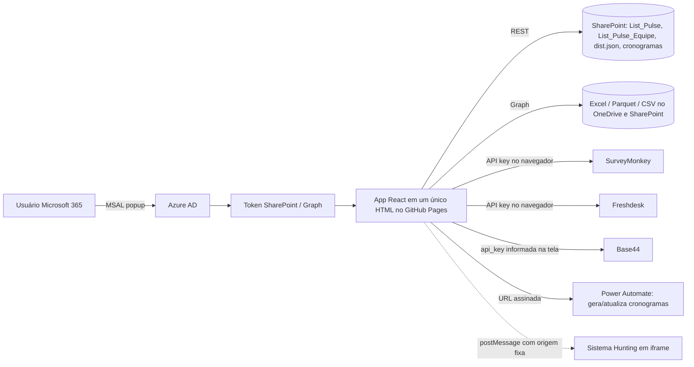

# Controle de Entregas / App Entregas (`controle_entregas`) — Documentação técnica e funcional

> Repositório: `Cia-Talentos-DataHub/controle_entregas` (**público**, 202 commits quase todos "Add files via upload" de Lucas Moreira). Publicado no **GitHub Pages** (`https://cia-talentos-datahub.github.io/controle_entregas/`). É um **único arquivo HTML de 22.360 linhas (≈ 1,25 MB)** com uma aplicação **React 18 sem build** (JSX já compilado para `React.createElement`) que serve de **portal interno de gestão das entregas da Cia de Talentos**: alocação de analistas e heads nos programas, cronograma, "pulse" dos processos seletivos, parceiros, NPS/CSAT, atendimento (CX/Freshdesk), inscrições, escopo de vagas e o painel gerencial. Todos os dados vivem em **listas e arquivos do SharePoint/OneDrive** (via Microsoft Graph e REST do SharePoint) e em APIs de terceiros chamadas **direto do navegador**. Escrito para que alguém que nunca viu o sistema entenda o negócio e consiga **recriá-lo do zero**.
>
> **Aviso de segurança:** o arquivo contém **chaves de API em texto claro** (SurveyMonkey e Freshdesk) e a URL com assinatura de um fluxo do Power Automate, em repositório **público**. Os valores foram **redigidos** neste documento; ver §12.

## 1. O que é e para quem serve
**Problema de negócio.** A CT executa programas de seleção em paralelo (planejamento → inscrições → ranking → até 5 etapas de avaliação → relatório final), cada um com consultores/analistas e "heads" alocados em percentuais por fase. A diretoria e os líderes precisam saber **quem está sobrecarregado, o que está atrasado, como os clientes avaliam (NPS/CSAT) e como está o atendimento ao candidato**, sem planilhas dispersas. O App Entregas concentra isso, com permissões por papel.

| Perfil (coluna `Acesso` da lista de equipe) | O que vê |
|---|---|
| **Nível 1 ou 2** | Acesso completo: gestão, alocação, edição de projetos, NPS, CX, escopo, analytics. Nível 1 vê também ações extras (CX, administração). |
| **Nível ≥ 3** | Apenas o módulo "Pulse"/solicitações. |
| **99 (não encontrado)** | Usuário fora da lista de equipe: sem acesso aos módulos de gestão. |
| **Função** (`Classificacao`: Analista, Consultor, KA, EB, C&D…) | Libera módulos específicos (por exemplo C&D para o módulo de Carreira e Desenvolvimento). |

## 2. Glossário
| Termo | Significado |
|---|---|
| **Programa / projeto** | Um processo seletivo ou entrega para um cliente; linha da lista `List_Pulse`. |
| **Fases** | `Planejamento`, `Inscrições`, `Ranking`, `Etapa 1…5`, `Relatório Final`; cada fase tem início, fim e % de alocação. |
| **Analista / Head / KA** | Papéis alocados ao programa (até 8 analistas e 3 heads); KA é o gestor da conta. |
| **Alocação** | Soma, por pessoa e período, do % × proporção de dias da fase dentro do período. |
| **Ciclo** | Ciclo orçamentário (ano/semestre/trimestre) do programa. |
| **Pulse** | Acompanhamento de cada processo (etapas, atingimento de metas, "pedras": Diamante, Safira, Rubi). |
| **NPS / CSAT** | Satisfação de clientes e candidatos (SurveyMonkey / Excel). |
| **CX** | Atendimento ao candidato via **Freshdesk**. |
| **Globe Fotografia** | Análises de inscritos lidas de arquivos Parquet no SharePoint (base do ATS Globe). |
| **dist.json** | Arquivo de distribuição (percentuais por pessoa, projetos locais, férias) guardado como anexo de um item oculto da lista. |
| **Moskit / Base44** | CRM e plataforma de apps; fornecem empresas/negócios para os módulos de parceiros e clientes. |

## 3. Fluxos

Ciclo de uso: login → carrega `List_Pulse` (todos os programas, paginação de 500), `List_Pulse_Equipe` (acesso e função), listas de heads/KA e o `dist.json` → monta a visão → edições gravam por `PATCH/POST` no SharePoint e o `dist.json` com trava de gravação.

## 4. Arquitetura, stack e arquivos
- **Front-end**: React 18 e ReactDOM (UMD do unpkg), **MSAL Browser 2.38.3**, **PapaParse**, **SheetJS (xlsx 0.18.5)**, **Tailwind (CDN)** e **hyparquet** (leitura de Parquet no navegador, via esm.sh). Sem build, sem servidor próprio; a persistência é o SharePoint.
- Estado: `useState` no componente `App` (≈ 1.000 linhas), `localStorage` para configuração leve (`ct_aloc_v4`), referências (`useRef`) para evitar *stale closures* e travar gravações concorrentes do `dist.json`.
- **Um arquivo**: `controle_entregas.html` (CSS no cabeçalho, 22 mil linhas de JS inline).

| Bloco do arquivo | Linhas aprox. | Conteúdo |
|---|---|---|
| Constantes e configuração | 59–330 | `APP_CONFIG`, `PHASES`, URLs de sites/listas SharePoint, campos do Pulse, de-para de responsáveis. |
| Datas, alocação e cálculos | 750–1270 | `parseSPItem`, `buildSPPayload`, `computeAllocations*` (mensal/semanal/diário), alocação de heads. |
| Autenticação e integrações | 1351–1740 | MSAL, entrega de token ao iframe do Hunting, SurveyMonkey, Freshdesk, Graph/Excel. |
| Cronograma | 2241–3040 | Upload/leitura de Excel de cronograma no SharePoint e geração de HTML do cronograma. |
| SharePoint REST | 3043–3730 | Leitura/escrita de listas, equipe, acesso, `dist.json`, nomes de campos. |
| Visões | 3888–22360 | Inscrições, Globe Fotografia, Parceiros, Dashboard, Projetos, Pulse, Calendário, Clientes × Frentes, Analytics, CSAT, NPS, CX Analytics, CX Atendimento, Escopo, C&D gerencial. |

## 5. Variáveis de ambiente / configuração
Não há `.env`. A configuração é **constante no código**: `APP_CONFIG.clientId` e `tenantId` (aplicativo do Azure AD, identificadores públicos de SPA), URLs de sites SharePoint (`ciadetalentos-my.sharepoint.com/personal/...`, `ciadetalentos.sharepoint.com/sites/Arquivos` e `/sites/Public`), nomes de listas (`List_Pulse`, `List_Pulse_Equipe`), pasta de cronogramas, **token do SurveyMonkey**, **chave do Freshdesk**, URL do fluxo Power Automate, origem permitida do Hunting. A chave do Base44 é digitada na tela e guardada numa linha de configuração no SharePoint (§12).

## 6. Dados
- **Lista `List_Pulse`** (SharePoint, uma linha por programa): `Nome_Programa`, `Cliente`, `Status_Programa`, `Ciclo_Orcamentario`, `Trimestre_Orcamentario`, `Periodo`, `KA`, `Codigo_Proposta`, `Publico`, `Pedra`, `Responsavel_Pedra`, `Analista_1..8`, `Head_1..3`, para cada fase `Inicio_<fase>`, `Fim_<fase>` (`Termino_Ranking` no Ranking), `Analista_<fase>_PCT` e `Consultor_Head_<fase>_PCT`, `NPS_cliente_1..3`, `Etapa_Processo`, `ID_do_Programa_ATS`, `FrenteNegocio` e dezenas de campos de pulse (tipo de etapa, posição Presencial/Online/Híbrido, atingimento de meta etc.).
- **Lista `List_Pulse_Equipe`**: pessoas, `Acesso` (1, 2, 3…), `Classificacao` (função), e-mail.
- **`dist.json`** como anexo de um item oculto: distribuições por pessoa/fase, projetos locais, férias.
- **Arquivos**: Excel de cronograma por projeto (pasta `.../80_20_copia/Cronogramas`), Parquet da Fotografia Globe por ano, CSV Moskit, planilhas de NPS, respostas de pesquisas.
- **Sem banco relacional**; não há esquema SQL.

## 7. Autenticação e autorização
- **Microsoft Entra ID (Azure AD)** com MSAL (popup) e escopos de SharePoint; o acesso é por **usuário** (delegado), então o SharePoint aplica as permissões da lista.
- O nível vem de `List_Pulse_Equipe`: procura o e-mail do usuário em **qualquer campo de texto** do item; sem correspondência o nível é 99.
- **As regras de visibilidade das telas estão no navegador**; quem tem token do SharePoint pode chamar a API REST diretamente. A proteção real é a permissão da lista no SharePoint.
- Integração com o **Sistema Hunting** (site `companhiadetalentos.com.br`) em iframe: responde a `postMessage` apenas dessa origem exata, entregando um token de SharePoint do usuário já logado (nunca Graph).

## 8. Interfaces (módulos)
Gestão (dashboard, grade mensal, projetos, sugestões, alocação simplificada), Pulse (acompanhamento dos processos), Parceiros (sincronização de empresas com o Base44), Clientes × Frentes (treemap por frente/produto), Analytics, NPS (clientes e candidatos), CSAT, CX Analytics e CX Atendimento (tickets, SLA, backlog, incidentes), Calendário (mês/semana/dia por fase), Inscrições (perfil dos inscritos), Globe Fotografia (diversidade, localização, formação), Vagas: Escopo, Requisitos e Remuneração, C&D gerencial e Hunting.

## 9. Regras de negócio
1. **Alocação mensal**: para cada analista, programa e fase, `pct × (dias da fase dentro do mês ÷ dias do mês)`, somado e arredondado. As versões semanal e diária seguem a mesma lógica; **heads** contam 100% por projeto-fase supervisionado, dividido pelo número de heads do projeto.
2. **% por fase**: o SharePoint guarda o total da fase; o app divide igualmente entre os analistas do projeto (`perEach = round(total ÷ n)`), e as distribuições desiguais ficam no `dist.json`.
3. Fases com datas e sem %, como o Ranking, não geram alocação (`PHASE_NO_PCT`). O placeholder `.Selecione um(a) Talent` é ignorado.
4. **Semáforo** das células (verde/amarelo/vermelho) mostra o nível de ocupação.
5. **Gravação segura do `dist.json`**: trava (`saveLockRef`) impede dois saves paralelos; se a leitura do arquivo falhar, os saves ficam bloqueados para não sobrescrever com um objeto vazio; o novo `indice` do projeto usa referência atual para evitar duplicidade.
6. **Nomes internos dos campos** do SharePoint (podem estar codificados, como `NPS_x005f_cliente_x005f_1`) são resolvidos em tempo de execução (`fetchSPChoices`, `_resolveFieldName`); colunas inexistentes são omitidas do `$select`.
7. **NPS**: o indicador é classificado em zonas — **Excelência** (≥ 75), **Qualidade** (≥ 50), **Aperfeiçoamento** (≥ 0) e **Crítica** (< 0) —, com métricas por ciclo; os ciclos 2026/2027 em diante vêm do SurveyMonkey; há campo para considerar o programa em outro ciclo.
8. **CSAT**: seis pesquisas do SurveyMonkey (Planejamento, Inscrições, Etapas Comportamentais 1–3, Contínuos e VP) mapeadas aos programas.
9. **Cronograma**: gera Excel (etapas, atividades, materiais) e um HTML do cronograma, grava no SharePoint e aciona o fluxo do Power Automate.

## 10. Roteiro para recriar e checklist
1. No Azure AD, registrar um aplicativo **SPA** com a URL do Pages e permissões delegadas de SharePoint (e Graph para arquivos); anotar `clientId` e `tenantId`.
2. Criar no SharePoint as listas `List_Pulse` e `List_Pulse_Equipe` (com as colunas do §6) e as pastas de cronogramas e de arquivos.
3. Criar o HTML base com React/MSAL/Tailwind por CDN e implementar: MSAL, camada REST do SharePoint, `parseSPItem`/`buildSPPayload`, cálculos de alocação, `App` com módulos e permissões.
4. Integrar SurveyMonkey, Freshdesk e Base44 **por um backend/proxy** (não do navegador).
5. Publicar (de preferência em hospedagem autenticada) e testar com usuários de cada nível.

**Checklist**: [ ] repositório privado ou hospedagem autenticada · [ ] chaves de terceiros rotacionadas e movidas para um proxy · [ ] URL do Power Automate com segredo regenerada · [ ] permissões de lista no SharePoint revisadas · [ ] arquivo dividido em módulos com build.

## 11. Apêndices — código-fonte real (chaves redigidas)
### 11.1 Cabeçalho (bibliotecas) e configuração
```html
<!DOCTYPE html>
<html lang="pt-BR">
<head>
<meta charset="UTF-8"/>
<meta name="viewport" content="width=device-width, initial-scale=1.0"/>
<meta http-equiv="Cache-Control" content="no-cache, no-store, must-revalidate"/>
<meta http-equiv="Pragma" content="no-cache"/>
<meta http-equiv="Expires" content="0"/>
<title>Controle Entregas — Cia de Talentos</title>
<script src="https://unpkg.com/react@18/umd/react.production.min.js"></script>
<script src="https://unpkg.com/react-dom@18/umd/react-dom.production.min.js"></script>
<script src="https://unpkg.com/@azure/msal-browser@2.38.3/lib/msal-browser.min.js"></script>
<script>
  // Shim: normalize whatever global the CDN version exposes → always window.msal
  if (typeof msal === 'undefined') {
    window.msal = window.msalBrowser || window['@azure/msal-browser'] || null;
  }
</script>
<script src="https://unpkg.com/papaparse@5.4.1/papaparse.min.js"></script>
<script src="https://cdnjs.cloudflare.com/ajax/libs/xlsx/0.18.5/xlsx.full.min.js"></script>
<script src="https://cdn.tailwindcss.com"></script>

<script type="module">
  import * as hyp from 'https://esm.sh/hyparquet@1';
  import { compressors as hyparquetCompressors } from 'https://esm.sh/hyparquet-compressors';
  window._hyparquet = hyp;
  window._hyparquetCompressors = hyparquetCompressors;
</script>
<style>
  body { font-family:'Segoe UI',sans-serif; background:#f8fafc; }
  .fade-in { animation:fadeIn .25s ease; }
...
// ═══════════════════════════════════════════════════════════════════════════════
//  CONFIGURAÇÃO DO ADMINISTRADOR — preencher UMA VEZ e distribuir o arquivo
//  Passo 1: portal.azure.com → Azure Active Directory → Registros de aplicativo
//  Passo 2: Novo registro → URI de redirecionamento: SPA → URL onde o arquivo será acessado
//  Passo 3: Permissões de API → SharePoint → AllSites.ReadWrite → Consentimento de admin
// ═══════════════════════════════════════════════════════════════════════════════
const APP_CONFIG = {
  clientId: '<CLIENT_ID_DO_APP_AZURE>',
  tenantId: '<TENANT_ID>'
};
// ═══════════════════════════════════════════════════════════════════════════════

// ─── Constants ────────────────────────────────────────────────────────────────
const PHASES = [{
  key: 'Planejamento',
  label: 'Planejamento',
  group: 'Planejamento'
}, {
  key: 'Inscricao',
  label: 'Inscrições',
  group: 'Inscrições'
}, {
  key: 'Ranking',
  label: 'Ranking',
  group: 'Ranking'
}, {
  key: 'Etapa_1',
  label: 'Etapa 1',
  group: 'Etapas de Avaliação'
}, {
  key: 'Etapa_2',
  label: 'Etapa 2',
  group: 'Etapas de Avaliação'
}, {
  key: 'Etapa_3',
  label: 'Etapa 3',
  group: 'Etapas de Avaliação'
}, {
  key: 'Etapa_4',
  label: 'Etapa 4',
  group: 'Etapas de Avaliação'
}, {
  key: 'Etapa_5',
  label: 'Etapa 5',
  group: 'Etapas de Avaliação'
}, {
  key: 'Relatorio_Final',
  label: 'Relatório Final',
  group: 'Relatório Final'
}];
// Colunas SP que diferem do padrão Fim_${key} para a data de término da fase
const PHASE_END_COLS = {
  Ranking: 'Termino_Ranking'
};
// Fases que não possuem colunas de PCT no SP (somente datas de início/fim)
const PHASE_NO_PCT = new Set(['Ranking']);
const MAX_ANALYSTS = 8;
const ANALYST_KEYS = Array.from({
  length: MAX_ANALYSTS
}, (_, i) => `Analista_${i + 1}`);
const SP_SITE_URL = 'https://ciadetalentos-my.sharepoint.com/personal/automacoes_fpa_ciadetalentos_com';
// Site das listas de parceiros (lucas_moreira tem permissão de owner aqui)
const SP_PARC_SITE_URL = 'https://ciadetalentos-my.sharepoint.com/personal/lucas_moreira_ciadetalentos_com';
const SP_LIST_NAME = 'List_Pulse';
const SP_TEAM_LIST = 'List_Pulse_Equipe';
const SP_SCOPE = 'https://ciadetalentos-my.sharepoint.com/.default';
const SP_ENTITY = 'SP.Data.List_PulseListItem';
const PLACEHOLDER = '.Selecione um(a) Talent';
const LS_KEY = 'ct_aloc_v4';
const HEAD_KEYS = ['Head_1', 'Head_2', 'Head_3'];
// Nomes candidatos (padrão). Serão validados/substituídos em runtime via fetchHeadPctCols().
const HEAD_PCT_COLS_DEFAULT = {
  Planejamento: 'Consultor_Head_Planejamento_PCT',
  Inscricao: 'Consultor_Head_Inscricao_PCT',
  Etapa_1: 'Consultor_Head_Etapa_1_PCT',
  Etapa_2: 'Consultor_Head_Etapa_2_PCT',
  Etapa_3: 'Consultor_Head_Etapa_3_PCT',
  Etapa_4: 'Consultor_Head_Etapa_4_PCT',
  Etapa_5: 'Consultor_Head_Etapa_5_PCT',
  Relatorio_Final: 'Consultor_Head_Relatorio_Final_P' // StaticName truncado no SP (32 chars max)
};
// Resolvido em runtime — começa com os defaults e é atualizado após fetchHeadPctCols
const HEAD_PCT_COLS = {
  ...HEAD_PCT_COLS_DEFAULT
};

// Busca todos os campos da lista SP e resolve os StaticNames reais das colunas Head PCT.
```
### 11.2 Leitura do item do SharePoint e cálculo de alocação
```javascript
// ─── Parse SharePoint Item → internal model ───────────────────────────────────
// phases[key].pcts     = number[] (one per analyst, same order as analysts[])
// headPhases[key].pcts = number[] (one per head,    same order as head1/2/3)
function parseSPItem(item) {
  const analysts = ANALYST_KEYS.map(k => (item[k] || '').trim()).filter(a => a && a !== PLACEHOLDER);
  const n = Math.max(analysts.length, 1);
  const phases = {};
  PHASES.forEach(ph => {
    const tot = PHASE_NO_PCT.has(ph.key) ? 0 : parsePct(item[`Analista_${ph.key}_PCT`]);
    const perEach = tot > 0 ? Math.round(tot / n) : 0;
    phases[ph.key] = {
      start: item[`Inicio_${ph.key}`] || null,
      end: item[PHASE_END_COLS[ph.key] || `Fim_${ph.key}`] || null,
      pcts: analysts.map(() => perEach)
    };
  });
  // Head phases — total lido do SP; distribuição per-head restaurada pelo mergeProjectsWithDist
  const projHeadNames = HEAD_KEYS.map(k => (item[k] || '').trim()).filter(h => h && h !== PLACEHOLDER);
  const nh = Math.max(projHeadNames.length, 1);
  const headPhases = {};
  PHASES.forEach(ph => {
    // Tenta o nome mapeado e o default como fallback para máxima robustez
    const colName = PHASE_NO_PCT.has(ph.key) ? null : HEAD_PCT_COLS[ph.key] || HEAD_PCT_COLS_DEFAULT[ph.key];
    const tot = colName ? parsePct(item[colName]) || parsePct(item[HEAD_PCT_COLS_DEFAULT[ph.key]]) : 0;
    const perEach = tot > 0 ? Math.round(tot / nh) : 0;
    headPhases[ph.key] = {
      start: item[`Inicio_${ph.key}`] || null,
      end: item[PHASE_END_COLS[ph.key] || `Fim_${ph.key}`] || null,
      pcts: projHeadNames.map(() => perEach)
    };
  });
  // Populate pulseData — lê pelo StaticName real do SP (override > f.k original)
  const pulseData = {};
  PULSE_FIELDS.forEach(f => {
    const spKey = _spFieldMap[f.k] && _spFieldMap[f.k] !== '__nonexistent__' ? _spFieldMap[f.k] : f.k;
    const raw = item[spKey] !== undefined ? item[spKey] : item[f.k];
    pulseData[f.k] = f.t === 'date' ? fmtDateForInput(raw) || '' : raw !== undefined && raw !== null ? String(raw) : '';
  });
  return {
    id: String(item.Id || item.indice || 'r' + Math.random()),
    spId: item.Id || item.id || null,
    indice: Number(item.indice) || 0,
    title: item.Nome_Programa || item.Title || 'Sem título',
    client: item.Cliente || '',
    status: item.Status_Programa || '',
    ciclo: item.Ciclo_Orcamentario || '',
    ka: item.KA || '',
    trimestre: item.Trimestre_Orcamentario || '',
    semestre: item.Periodo || '',
    codigoProposta: item.Codigo_Proposta || '',
    publico: item.Publico || '',
    pedra: item.Pedra || '',
    respPedra: normRespPedra(item.Responsavel_Pedra || ''),
    tipoProg: item.Tipo_Programa || '',
    qtdVagas: Number(item.Quantidade_Vagas_Prevista) || 0,
    solucao: normFrente(item.FrenteNegocio || ''),
    // nova coluna Frente de Negócio (SP: FrenteNegocio)
    produto: item.Produto_Principal || '',
    farol: item.Farol_Vermelho || '',
    vagasTrab: Number(item[_spFieldMap['Vagas_Trabalhadas'] || 'Vagas_Trabalhadas']) || 0,
    vagasFech: Number(item[_spFieldMap['Vagas_Fechadas'] || 'Vagas_Fechadas']) || 0,
    vagasExtra: Number(item[_spFieldMap['Vagas_Extras'] || 'Vagas_Extras']) || 0,
    vagasCanc: Number(item[_spFieldMap['Vagas_Canceladas'] || 'Vagas_Canceladas']) || 0,
    vagasNaoFech: Number(item[_spFieldMap['Vagas_Nao_Fechadas'] || 'Vagas_Nao_Fechadas']) || 0,
    motivosCelebrar: item[_spFieldMap['Motivos_Celebrar'] || 'Motivos_Celebrar'] || '',
    devemosCuidar: item[_spFieldMap['Devemos_Cuidar'] || 'Devemos_Cuidar'] || '',
    resumoSemanal: item[_spFieldMap['Resumo_Semanal'] || 'Resumo_Semanal'] || '',
    head1: item.Head_1 || '',
    head2: item.Head_2 || '',
    head3: item.Head_3 || '',
    source: 'sharepoint',
    analysts,
    phases,
    headPhases,
    pulseData
  };
}

// ... computeAllocations ...
// ─── Compute Allocations (day-weighted, per-analyst pct) ──────────────────────
function computeAllocations(projects) {
  const result = {};
  projects.forEach(proj => {
    proj.analysts.forEach((analyst, idx) => {
      if (!analyst) return;
      if (!result[analyst]) result[analyst] = {};
      PHASES.forEach(ph => {
        const phase = proj.phases[ph.key];
        const pct = phase?.pcts?.[idx] || 0;
        if (!phase?.start || !phase?.end || !pct) return;
        const sMk = monthKey(parseSPDate(phase.start));
        const eMk = monthKey(parseSPDate(phase.end));
        if (!sMk || !eMk) return;
        rangeMonths(sMk, eMk).forEach(mk => {
          const [y, m] = mk.split('-').map(Number);
          const dim = new Date(y, m, 0).getDate();
          const ov = daysOverlapInMonth(phase.start, phase.end, mk);
          result[analyst][mk] = (result[analyst][mk] || 0) + pct * (ov / dim);
        });
      });
    });
  });
  Object.values(result).forEach(a => Object.keys(a).forEach(mk => {
    a[mk] = Math.round(a[mk]);
  }));
  return result;
}
```
### 11.3 Autenticação (MSAL) e ponte com o Hunting
```javascript
// ─── MSAL ─────────────────────────────────────────────────────────────────────
let _msalApp = null;
function getMsalApp(clientId, tenantId) {
  if (_msalApp) return _msalApp;
  if (!window.msal) throw new Error('Biblioteca MSAL não carregou. Verifique sua conexão com a internet e recarregue a página. O arquivo deve ser acessado via http:// (não file://).');
  _msalApp = new msal.PublicClientApplication({
    auth: {
      clientId,
      authority: `https://login.microsoftonline.com/${tenantId || 'common'}`,
      redirectUri: window.location.origin + window.location.pathname
    },
    cache: {
      cacheLocation: 'sessionStorage',
      storeAuthStateInCookie: false
    }
  });
  return _msalApp;
}
async function acquireToken(clientId, tenantId) {
  const app = getMsalApp(clientId, tenantId);
  await app.initialize();
  const accounts = app.getAllAccounts();
  if (accounts.length === 0) {
    const res = await app.loginPopup({
      scopes: [SP_SCOPE]
    });
    return {
      token: res.accessToken,
      user: res.account?.name || res.account?.username || 'Usuário',
      email: res.account?.username || ''
    };
  }
  try {
    const res = await app.acquireTokenSilent({
      scopes: [SP_SCOPE],
      account: accounts[0]
    });
    return {
      token: res.accessToken,
      user: accounts[0]?.name || accounts[0]?.username || 'Usuário',
      email: accounts[0]?.username || ''
    };
  } catch {
    const res = await app.loginPopup({
      scopes: [SP_SCOPE]
    });
    return {
      token: res.accessToken,
      user: res.account?.name || res.account?.username || 'Usuário',
      email: res.account?.username || ''
    };
  }
}
async function signOutMsal(clientId, tenantId) {
  try {
    const app = getMsalApp(clientId, tenantId);
    await app.initialize();
    const account = app.getAllAccounts()[0];
    if (account) await app.logoutPopup({
      account
    });
  } catch {}
  sessionStorage.clear();
  _msalApp = null;
}

// ─── Sistema Hunting (iframe): entrega do login já feito no App Entregas ─────
// Só responde a mensagens 'hunting:token-request' vindas EXATAMENTE da origem do Hunting.
// Entrega sempre um token do SharePoint (mesmo tipo de acesso dos outros módulos, sem consentimento de admin);
// os escopos pedidos pelo iframe são ignorados de propósito (nada de Graph / Sites.ReadWrite.All).
// Não altera o fluxo de login/tokens dos demais módulos; qualquer erro é respondido ao iframe e ignorado aqui.
const HUNTING_ORIGIN = 'https://companhiadetalentos.com.br';
const HUNTING_SP_SCOPE = 'https://<tenant>.sharepoint.com/<link-redigido>
let _huntingTokenBusy = null;
window.addEventListener('message', async (e) => {
  try {
    if (e.origin !== HUNTING_ORIGIN || !e.data || e.data.type !== 'hunting:token-request') return;
    const reply = (payload) => { try { e.source && e.source.postMessage(payload, e.origin); } catch {} };
    try {
      if (!_huntingTokenBusy) {
        _huntingTokenBusy = (async () => {
          const app = getMsalApp(APP_CONFIG.clientId, APP_CONFIG.tenantId);
          await app.initialize();
          const account = app.getActiveAccount() || app.getAllAccounts()[0];
          if (!account) throw new Error('Usuário não autenticado no App Entregas');
          const req = { scopes: [HUNTING_SP_SCOPE], account };
          try { return await app.acquireTokenSilent(req); }
          catch { return await app.acquireTokenPopup(req); }
        })().finally(() => { _huntingTokenBusy = null; });
      }
      const r = await _huntingTokenBusy;
      reply({
        type: 'hunting:token',
        accessToken: r.accessToken,
        expiresOn: r.expiresOn ? r.expiresOn.getTime() : null,
        account: { email: r.account.username, name: r.account.name }
      });
    } catch (err) {
      reply({ type: 'hunting:token-error', message: String((err && err.message) || err) });
    }
  } catch {}
});
```
### 11.4 Integrações com chaves no navegador (SurveyMonkey, Freshdesk, Power Automate)
```javascript
const CRONOGRAMA_SITE_URL    = 'https://<tenant>.sharepoint.com/<link-redigido>
const CRONOGRAMA_SCOPE       = 'https://<tenant>.sharepoint.com/<link-redigido>
const CRONOGRAMA_FOLDER_REL  = '/sites/Arquivos/Documentos Compartilhados/80_20_copia/Cronogramas';
const CRONOGRAMA_PA_FLOW_URL = 'https://default<TENANT>.environment.api.powerplatform.com:443/powerautomate/automations/direct/cu/27/workflows/<ID_DO_FLUXO>/triggers/manual/paths/invoke?api-version=1&sp=%2Ftriggers%2Fmanual%2Frun&sv=1.0&sig=<REDIGIDO>';
const CRONOGRAMA_COLORS = ['#1e3a5f','#4a7fb5','#2d7a4f','#b5793a','#7b3a9f','#c05050','#3a9f7b','#3a7b9f','#9f9f3a','#c47a3a'];

// ─── SurveyMonkey CSAT ────────────────────────────────────────────────────────
const SM_TOKEN = '<TOKEN_REDIGIDO>';
const SM_SURVEYS = [{
  id: '418536546',
  label: 'Planejamento'
}, {
  id: '418576746',
  label: 'Inscrições'
}, {
  id: '418577107',
  label: 'Etapa Comportamental 1'
}, {
  id: '523535499',
  label: 'Etapa Comportamental 2'
}, {
  id: '523535535',
  label: 'Etapa Comportamental 3'
}, {
  id: '523675232',
  label: 'Contínuos e VP'
}];
async function smFetch(path, _retry) {
  _retry = _retry || 0;
  const res = await fetch('https://api.surveymonkey.com/v3' + path, {
    headers: {
      'Authorization': 'Bearer ' + SM_TOKEN,
      'Content-Type': 'application/json'
    }
  });
  if (res.status === 429 && _retry < 4) {
    await new Promise(r => setTimeout(r, (1 << _retry) * 2000));
    return smFetch(path, _retry + 1);
  }
  if (!res.ok) {
    let msg = 'SM API ' + res.status;
    try { const j = await res.json(); msg += ' — ' + (j.error?.message || JSON.stringify(j)); } catch {}
    throw new Error(msg);
  }
  return res.json();
}

// ... Freshdesk ...
// ─── CX / Freshdesk ───────────────────────────────────────────────────────────
const FD_DOMAIN = 'ciadetalentos';
const FD_KEY = '<CHAVE_REDIGIDA>';
const FD_BASE = `https://${FD_DOMAIN}.freshdesk.com/api/v2`;
const FD_AUTH = 'Basic ' + btoa(`${FD_KEY}:X`);
const FD_STATUS_LABEL = {
  2: 'Aberto',
  3: 'Pendente',
  4: 'Resolvido',
  5: 'Fechado',
  6: 'Aguard. Cliente',
  7: 'Aguardando Terceiros'
};
const FD_STATUS_COLOR = {
  2: 'bg-blue-100 text-blue-700',
  3: 'bg-amber-100 text-amber-700',
  4: 'bg-green-100 text-green-700',
  5: 'bg-slate-100 text-slate-600',
  6: 'bg-orange-100 text-orange-700',
  7: 'bg-purple-100 text-purple-700'
};
// PS values to exclude from "por processo seletivo" breakdown
const FD_PS_EXCLUDE = new Set(['Não relacionado a processo seletivo - Cadastro', 'Não encontrei na lista']);
async function fdFetch(path) {
  const r = await fetch(FD_BASE + path, {
    headers: {
      'Authorization': FD_AUTH,
      'Content-Type': 'application/json'
    }
  });
  if (!r.ok) {
    const txt = await r.text().catch(() => '');
    throw new Error(`Freshdesk ${r.status}: ${txt.slice(0, 250)}`);
  }
```
### 11.5 Acesso do usuário e gravação no SharePoint
```javascript
// ─── SharePoint REST ──────────────────────────────────────────────────────────
async function spFetch(token, url, opts = {}) {
  const res = await fetch(url, {
    ...opts,
    headers: {
      'Authorization': `Bearer ${token}`,
      'Accept': 'application/json;odata=nometadata',
      ...(opts.headers || {})
    }
  });
  if (!res.ok) {
    const t = await res.text().catch(() => '');
    throw new Error(`SP ${res.status}: ${t.slice(0, 600)}`);
  }
  if (res.status === 204) return null;
  const text = await res.text();
  if (!text || !text.trim()) return null;
  return JSON.parse(text);
}
function _spListBase(siteUrl, listName) {
  // Use GetList with server-relative URL — more reliable than GetByTitle
  const rel = new URL(siteUrl).pathname.replace(/\/$/, '');
  return `${siteUrl}/_api/web/GetList('${rel}/Lists/${listName}')`;
}

async function fetchUserAccess(token, siteUrl, email) {
  try {
    const base = _spListBase(siteUrl, SP_TEAM_LIST);
    const lowerEmail = (email || '').toLowerCase().trim();
    // Sem $select — retorna todos os campos, evita erros com nomes internos diferentes
    const json = await spFetch(token, `${base}/items?$top=500`);
    const items = json.value || [];
    // Procura o item onde QUALQUER campo string contenha o e-mail do usuário
    const item = items.find(i => Object.values(i).some(v => typeof v === 'string' && v.toLowerCase().trim() === lowerEmail));
    if (!item) return {
      level: 99,
      funcao: ''
    };
    // Tenta variações comuns do nome interno da coluna Acesso
    const raw = item['Acesso'] ?? item['acesso'] ?? item['Acesso0'] ?? item['N_x00famero'] ?? null;
    const val = raw === null || raw === undefined ? 99 : parseInt(raw) || 99;
    // Lê coluna Classificacao — é onde ficam os papéis: Analista, Consultor, KA, EB, C&D, etc.
    const funcao = String(item['Classificacao'] ?? item['classificacao'] ?? '').trim();
    return {
      level: isNaN(val) ? 99 : val,
      funcao
    };
  } catch (e) {
    return {
      level: 99,
      funcao: ''
    };
  }
}
async function patchSPItem(token, siteUrl, listName, spId, payload) {
  await spFetch(token, `${_spListBase(siteUrl, listName)}/items(${spId})`, {
    method: 'POST',
    headers: {
      'Content-Type': 'application/json;odata=nometadata',
      'X-HTTP-Method': 'MERGE',
      'If-Match': '*'
    },
    body: JSON.stringify(payload)
  });
}
async function createSPItem(token, siteUrl, listName, payload) {
  const res = await fetch(`${_spListBase(siteUrl, listName)}/items`, {
    method: 'POST',
    headers: {
      'Authorization': `Bearer ${token}`,
      'Accept': 'application/json;odata=nometadata',
      'Content-Type': 'application/json;odata=nometadata'
    },
    body: JSON.stringify(payload)
  });
  if (!res.ok) {
    const t = await res.text().catch(() => '');
    throw new Error(`SP Create ${res.status}: ${t.slice(0, 200)}`);
  }
  return res.json();
}
```

## 12. Pontos de atenção
| # | Achado | Impacto / recomendação |
|---|---|---|
| 1 | **Repositório público e site público com chaves de API reais no JavaScript**: token do **SurveyMonkey** (`SM_TOKEN`), chave do **Freshdesk** (`FD_KEY`, com acesso a tickets e dados de candidatos) e **URL do Power Automate com assinatura (`sig=`)** que permite disparar o fluxo | **Prioridade máxima**: revogar/rotacionar as três credenciais agora, mover para um proxy/Function com autenticação e nunca expor segredos em front-end. Qualquer pessoa que abra o site vê as chaves. |
| 2 | O código é servido a qualquer visitante (a página só pede login Microsoft, mas o arquivo com configurações e lógica é público) | Expõe a estrutura interna (sites, listas, nomes de campos, regras de acesso). Hospedar atrás de autenticação (por exemplo, SharePoint, Static Web Apps com Entra ID). |
| 3 | Autorização **no navegador**: nível de acesso lido de `List_Pulse_Equipe` pelo próprio cliente e aplicado em condicionais da interface; a busca do e-mail percorre **todos** os campos de texto dos itens | Um usuário pode adulterar o estado no console; a segurança efetiva depende das permissões do SharePoint. Aplicar o princípio do menor privilégio nas listas. |
| 4 | Escopo amplo do aplicativo do Azure AD (o próprio código menciona `AllSites.ReadWrite` e consentimento de administrador) e o mesmo registro é usado por outras ferramentas | Reduzir permissões; usar um registro por aplicação. |
| 5 | **Arquivo único de 22 mil linhas, sem build, sem testes**, com HTML compilado de JSX e muitos módulos misturados | Manutenção arriscada: um erro de sintaxe derruba tudo e o histórico (202 commits "upload") não é revisável. Migrar para um projeto Vite/React com módulos e testes. |
| 6 | Dependências por CDN sem versão fixa (`react@18`, `esm.sh/hyparquet@1`, `cdn.tailwindcss.com`) | Mudança no CDN altera o app sem aviso; fixar versões e usar SRI. |
| 7 | Dados de pessoas (alocação, férias, desempenho, atendimento a candidatos, empresas parceiras) são baixados e processados inteiros no navegador; o `localStorage` guarda só configuração e preferências de tela (`ct_aloc_v4`, largura de colunas) | LGPD: minimizar o que é carregado por perfil (filtrar no servidor/consulta), registrar acessos e revisar o tempo de vida dos tokens. |
| 8 | A **chave do Base44** é digitada na tela e gravada em texto (`ConfigJson`) num item `__config_base44` da lista de parceiros no SharePoint | Visível para quem tem acesso de leitura à lista; usar cofre. |
| 9 | O `dist.json` é um arquivo único reescrito por todos os usuários (trava só local) | Dois usuários em máquinas diferentes podem sobrescrever o trabalho um do outro; usar lista com um item por registro ou controle de versão (ETag). |
| 10 | Nomes de pessoas (responsáveis por "pedras") e e-mails fixos no código | Regra de negócio e dados pessoais dentro do código; mover para listas. |
| 11 | Mesmo registro Azure (`clientId`/`tenantId`) aparece em outros repositórios da organização (por exemplo `ETL-omie`), onde o *secret* está no código | O comprometimento do segredo daquele repositório afeta também este aplicativo. Rotacionar o *secret* e separar os registros. |
